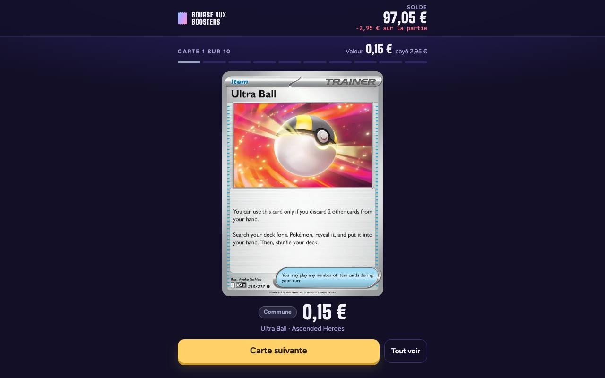
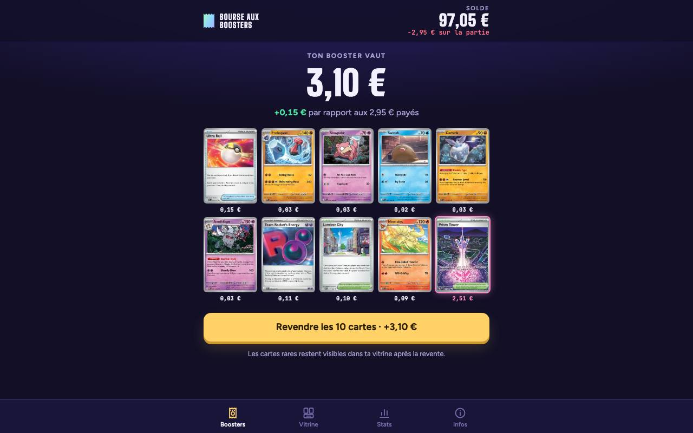

# Bourse aux Boosters

Ouvre des boosters virtuels de cartes Pokémon : vraies cartes, vraies photos, vraies cotes Cardmarket.

▶ **Jouer :** https://pokemon-booster.vercel.app (aussi sur https://alex12062012.github.io/pokemon-booster/)

| Une carte retournée | Le booster complet |
|---|---|
|  |  |

## Le jeu

- **Solde de départ** : 100 € virtuels. Un booster coûte **2,95 €** et contient **10 cartes**.
- **Ouverture** : on retourne les cartes une à une, ou on clique sur « Tout voir ». La **valeur réelle** de chaque carte s'affiche (cote Cardmarket), ainsi que le gain ou la perte par rapport au prix payé.
- **Revente** : on revend le booster pour récupérer sa valeur. Les cartes rares restent dans la **Vitrine**.
- **Onglets** : *Boosters*, *Vitrine*, *Stats* (bilan des ouvertures) et *Infos*.
- **Fonctionne sur téléphone** et s'installe comme une appli (manifeste et icônes PWA).

## Comment ça marche

- `scripts/build-data.mjs` récupère les cartes des séries les plus récentes et leurs cotes :
  - via l'API [pokemontcg.io](https://pokemontcg.io), ou [TCGdex](https://tcgdex.dev) en secours si elle est en panne ;
  - il écrit ensuite `public/cards.json` (les données du jeu) et `public/stats.json` (contrôles du calcul de prix).
- `public/engine.js` contient les taux de tirage par rareté et le calcul du prix du booster.
- `public/app.js` et `public/index.html` gèrent l'interface, les animations, la vitrine et les stats. Tout est sauvegardé dans le navigateur.

## Mise en ligne

Le workflow GitHub Actions *Mise en ligne* (`.github/workflows/deploy.yml`) se lance à chaque push et **chaque lundi** :
1. il régénère les données (la variable secrète `POKEMONTCG_API_KEY` est facultative) ;
2. il publie le dossier `public/` sur GitHub Pages.

Le site est aussi déployé sur Vercel.

## Lancer en local

```bash
npm run build          # télécharge les cartes et les cotes (Node 22)
npx serve public       # puis ouvre l'adresse affichée
```

---
*Jeu non officiel, sans lien avec The Pokémon Company ni Cardmarket.*
